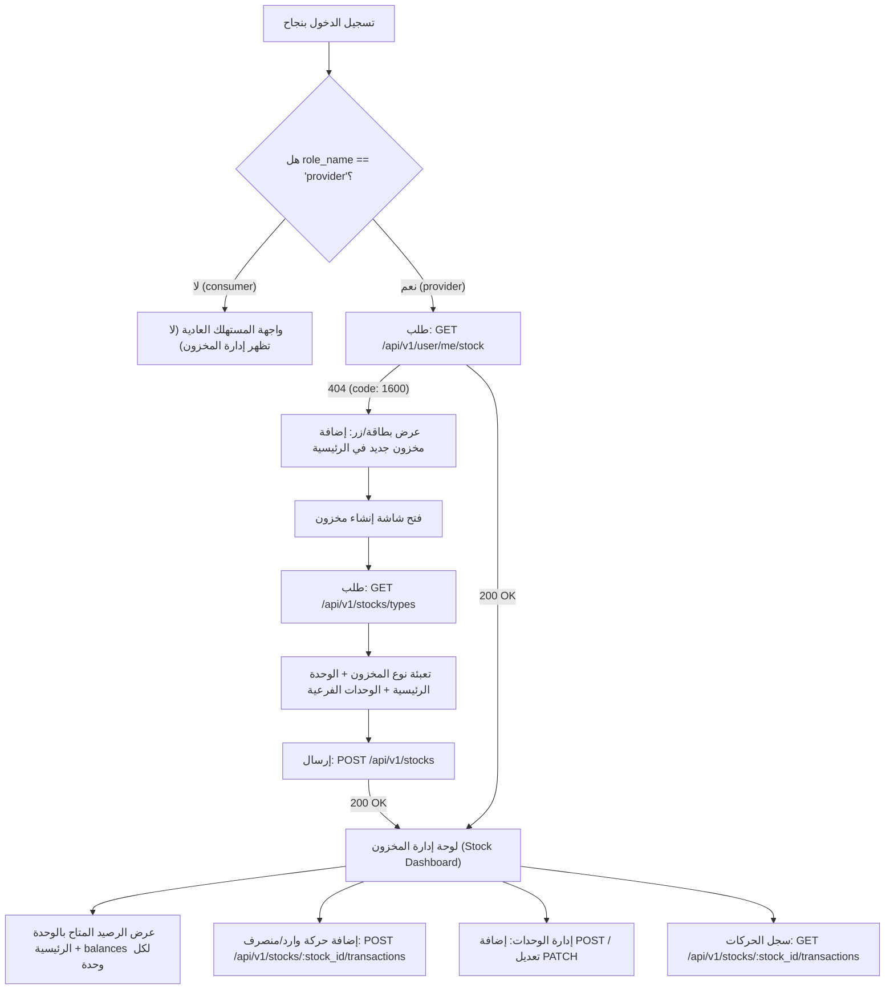

# دليل تكامل واجهة المستخدم (UI) لميزة المخزون — Nova API

> **مرجع قديم (نوفمبر 2026).** يصف هذا المستند واجهة المخزون الواحد السابقة. يستخدم التطبيق الحالي `/api/v1/stocks/me` للمخزون المتعدد ويحفظ العنوان وإحداثيات الموقع. راجع `src/services/api/modules/stock.api.js` واختبارات التكامل للمسارات الحالية.

> **تاريخ التوثيق:** 16 نوفمبر 2026  
> **النطاق:** تدفق العمل الكامل لميزة المخزون (`Stock` & `User Stock`) في واجهة المستخدم (Frontend / Mobile)  
> **المسارات الأساسية:** `/api/v1/user/me/stock` و `/api/v1/stocks`

---

## 1. نظرة عامة وقواعد أساسية للواجهة

- **المصادقة والجلسات (Session Cookies):**  
  جميع مسارات المخزون محمية بـ `SessionHandler`. يجب تفعيل إرسال الكوكيز في كل طلب:
  - **Axios:** `withCredentials: true`
  - **Fetch:** `credentials: 'include'`
  - في حال انتهاء الجلسة أو عدم تسجيل الدخول، يرجع الخادم `401 Unauthorized`.

- **من له صلاحية إدارة المخزون؟**  
  ميزة المخزون مخصصة لحساب **مزود الخدمة (`provider`)** (يتم التحقق من `user.role_name === "provider"` من استجابة تسجيل الدخول).  
  كل مزود خدمة يمتلك **مخزوناً واحداً فقط** على مستوى النظام.

- **هيكل الاستجابة الموحد:**
  - **النجاح:**
    ```json
    {
      "success": true,
      "data": { ... },
      "meta": { "page": 1, "per_page": 20, "total": 45, "total_pages": 3 } // في المسارات المرقمة فقط
    }
    ```
  - **الخطأ:**
    ```json
    {
      "success": false,
      "error": {
        "status": 404,
        "code": 1600,
        "message": "stock not found"
      }
    }
    ```

---

## 2. مخطط تدفق الشاشات (UI Flow Diagram)



---

## 3. رحلة المستخدم خطوة بخطوة في الـ UI

### الخطوة 1: فحص حالة المخزون في الصفحة الرئيسية (Home Screen)
عند دخول مزود الخدمة (`role_name === "provider"`) إلى الشاشة الرئيسية:

- **الطلب:**
  ```http
  GET /api/v1/user/me/stock
  ```
- **السيناريو (أ): المزود لا يملك مخزوناً بعد**
  - يستجيب الخادم برمز `404` وكود الخطأ `1600` (`stock not found`).
  - **ما يجب عرضه في الواجهة:**
    - إظهار حالة فارغة (Empty State) أو بطاقة واضحة في الرئيسية بعنوان **"إضافة مخزون جديد" (Add New Stock)**.
    - عند الضغط عليها، يتم توجيه المستخدم إلى شاشة إنشاء المخزون.

- **السيناريو (ب): المزود يملك مخزوناً بالفعل**
  - يستجيب الخادم برمز `200 OK` مع بيانات المخزون:
    ```json
    {
      "success": true,
      "data": {
        "id": "550e8400-e29b-41d4-a716-446655440000",
        "available": 120,
        "type": {
          "id": 1,
          "name": "مواد غذائية"
        },
        "units": [
          { "id": 10, "name": "حبة", "rate": 1, "is_main": true },
          { "id": 11, "name": "كرتون", "rate": 12, "is_main": false }
        ],
        "balances": [
          { "unit_id": 10, "unit": "حبة", "amount": 120 },
          { "unit_id": 11, "unit": "كرتون", "amount": 10 }
        ],
        "user_id": "11111111-2222-3333-4444-555555555555",
        "created_at": "2026-11-16T06:00:00Z",
        "updated_at": "2026-11-16T06:15:00Z"
      }
    }
    ```
  - **ما يجب عرضه في الواجهة:**
    - إخفاء زر "إضافة مخزون جديد" (لأن المزود يملك مخزوناً واحداً فقط).
    - عرض بطاقة **الرصيد المتاح حالياً**:
      - الرصيد الأساسي (`available`) مع اسم الوحدة الرئيسية (`is_main: true`).
      - قائمة أو شارات تعرض الرصيد المحوّل لكل وحدة من مصفوفة `balances` مباشرة (مثال: `120 حبة` | `10 كرتون`) دون الحاجة لحسابها في الواجهة.
    - أزرار الإجراءات السريعة: **توريد (إضافة كمية)**، **صرف (سحب كمية)**، **إدارة الوحدات**، **سجل الحركات**.

---

### الخطوة 2: شاشة إضافة مخزون جديد (Add New Stock)

#### 2.1 جلب أنواع المخزون (Stock Types)
فور فتح شاشة إنشاء المخزون، تقوم الواجهة بجلب قائمة التصنيفات لعرضها في قائمة منسدلة (Dropdown):
- **الطلب:**
  ```http
  GET /api/v1/stocks/types
  ```
- **الاستجابة (`200 OK`):**
  ```json
  {
    "success": true,
    "data": [
      { "id": 1, "name": "مواد غذائية" },
      { "id": 2, "name": "مياه ومشروبات" }
    ]
  }
  ```

#### 2.2 إعداد الوحدات (Units) وإرسال طلب الإنشاء
في نموذج الإنشاء، يختار المستخدم `stock_type_id` ويضيف الوحدات.
- **قواعد التحقق في الواجهة (UI Validation):**
  1. يجب اختيار `stock_type_id`.
  2. يجب إضافة **وحدة واحدة على الأقل**.
  3. يجب أن تكون هناك **وحدة رئيسية واحدة فقط** (`is_main: true`) ويكون معاملها ثابتاً `rate = 1` (يُفضّل جعل حقل المعامل للوحدة الرئيسية مقفلاً على `1`).
  4. أي وحدات إضافية تكون `is_main: false` ومعاملها عدد صحيح `rate >= 1` (مثل: `1 كرتون = 12 حبة`).
  5. عدم تكرار أسماء الوحدات (الحد الأقصى للاسم 50 حرفاً).

- **الطلب:**
  ```http
  POST /api/v1/stocks
  ```
  ```json
  {
    "stock_type_id": 1,
    "units": [
      { "name": "حبة", "rate": 1, "is_main": true },
      { "name": "كرتون", "rate": 12, "is_main": false }
    ]
  }
  ```
- **الاستجابة (`200 OK`):** ترجع كائن المخزن كاملاً (`StockResponse`) برصيد ابتدائي `available: 0`، وعندها يتم الانتقال إلى **لوحة إدارة المخزون**.
- **تنبيه الخطأ `409` (`code: 1611`):** إذا كان المستخدم يملك مخزوناً مسبقاً، يجب توجيهه مباشرة للوحة المخزون.

---

### الخطوة 3: عرض تفاصيل المخزون والرصيد الحالي
يمكن تحديث بيانات المخزون في أي وقت عبر أحد المسارين:
- للمستخدم الحالي (الأفضل في الرئيسية): `GET /api/v1/user/me/stock`
- أو عبر معرف المخزون: `GET /api/v1/stocks/:stock_id`

> **ملاحظة للواجهة:** اعتمد دائماً على مصفوفة `balances` الجاهزة لعرض المتوفر بكل وحدة (مثل `10.5 كرتون` أو `126 حبة`)، وعلى `available` للرصيد بالوحدة الرئيسية.

---

### الخطوة 4: تسجيل حركة مخزنية (إضافة / سحب كمية)
عند ضغط المستخدم على **"إضافة كمية (وارد)"** أو **"سحب كمية (منصرف)"**:

- **حقول النموذج:**
  - **الاتجاه (`is_in`):** `true` (إضافة/توريد) أو `false` (سحب/صرف).
  - **الوحدة (`unit_id`):** قائمة منسدلة من `stock.units` (مثلاً: حبة أو كرتون).
  - **الكمية (`amount`):** عدد صحيح موجب (`> 0`).
  - **الوصف (`description`):** نص اختياري (بحد أقصى 1000 حرف، مثل: "فاتورة شراء #102").

- **الطلب:**
  ```http
  POST /api/v1/stocks/:stock_id/transactions
  ```
  ```json
  {
    "amount": 5,
    "unit_id": 11,
    "is_in": true,
    "description": "توريد 5 كراتين"
  }
  ```
- **الاستجابة (`200 OK`):**
  ```json
  {
    "success": true,
    "data": {
      "id": "a2222222-3333-4444-5555-666666666666",
      "amount": 5,
      "unit": { "id": 11, "name": "كرتون", "rate": 12, "is_main": false },
      "stock_id": "550e8400-e29b-41d4-a716-446655440000",
      "is_in": true,
      "description": "توريد 5 كراتين",
      "user_id": "11111111-2222-3333-4444-555555555555",
      "created_at": "2026-11-16T06:20:00Z"
    }
  }
  ```
- **تحديث الواجهة بعد النجاح:** أعد استدعاء `GET /api/v1/user/me/stock` (أو حدث الحالة محلياً) لعرض الرصيد الجديد في `available` و `balances`.
- **معالجة خطأ نفاد الرصيد (`409`, `code: 1602`):** عند السحب بكمية أكبر من المتاح، اعرض رسالة تنبيه: *"الكمية المطلوبة غير متوفرة في المخزون"*.

---

### الخطوة 5: إدارة الوحدات (إضافة وتعديل)

#### 5.1 إضافة وحدة فرعية جديدة
- **الطلب:**
  ```http
  POST /api/v1/stocks/:stock_id/units
  ```
  ```json
  {
    "name": "طرد",
    "rate": 24,
    "is_main": false
  }
  ```
- **قواعد الواجهة:** يجب أن تكون `is_main: false` دائماً، و`rate >= 1`، والاسم غير مكرر.

#### 5.2 تعديل وحدة قائمة
- **الطلب:**
  ```http
  PATCH /api/v1/stocks/:stock_id/units/:unit_id
  ```
  ```json
  {
    "name": "كرتون كبير",
    "rate": 15
  }
  ```
  *(يمكن إرسال `name` فقط أو `rate` فقط أو كليهما).*
- **قواعد الواجهة الهامة:**
  - إذا كانت الوحدة رئيسية (`is_main: true`)، يجب **تعطيل تعديل حقل `rate`** في الواجهة (لأن معاملها يجب أن يبقى `1`).
  - إذا تم استخدام الوحدة مسبقاً في أي حركة، سيرفض الخادم تغيير `rate` برمز `409` (`code: 1610`). اعرض رسالة للمستخدم: *"لا يمكن تغيير معامل وحدة تم استخدامها في حركات سابقة، يمكنك تعديل الاسم فقط"*.

---

### الخطوة 6: شاشة سجل الحركات (Transactions History)
لعرض سجل الحركات المخزنية مع الترقيم والفلترة:

- **الطلب:**
  ```http
  GET /api/v1/stocks/:stock_id/transactions?page=1&page_size=20&is_in=true
  ```
- **معاملات الاستعلام (Query Parameters):**
  - `page`: رقم الصفحة (اختياري، الافتراضي `1`).
  - `page_size`: عدد العناصر في الصفحة (اختياري، الافتراضي `20`، الحد الأقصى `100`).
  - `is_in`: للفلترة — `true` (الوارد فقط)، `false` (المنصرف فقط)، أو بدون المعامل لعرض الكل.
- **الاستجابة (`200 OK`):**
  تحتوي على `data` (مصفوفة الحركات مرتبة من الأحدث للأقدم) و `meta` للتحكم بأزرار الصفحات (Pagination / Infinite Scroll).

---

## 4. قاموس أكواد أخطاء المخزون (Error Codes Reference)

| HTTP Status | Code | المعنى البرمجي | الرسالة المقترحة في واجهة المستخدم (UI) |
|---|---|---|---|
| `401` | `1100` | `ErrUnauthorized` | يرجى تسجيل الدخول للمتابعة |
| `404` | `1600` | `ErrStockNotFound` | لا يوجد مخزون مسجل (اعرض شاشة إضافة مخزون) |
| `400` | `1601` | `ErrUnitNotInStock` | الوحدة المختارة لا تنتمي لهذا المخزون |
| `409` | `1602` | `ErrInsufficientStock` | الرصيد المتاح غير كافٍ لإتمام عملية السحب |
| `400` | `1603` | `ErrInvalidAmount` | يجب أن تكون الكمية أكبر من صفر |
| `404` | `1604` | `ErrStockTypeNotFound` | نوع المخزون المختار غير موجود |
| `404` | `1605` | `ErrUnitNotFound` | الوحدة المطلوبة غير موجودة |
| `400` | `1606` | `ErrMainUnitRequired` | يجب تحديد وحدة رئيسية واحدة فقط للمخزون |
| `400` | `1607` | `ErrMainUnitRate` | معامل الوحدة الرئيسية يجب أن يساوي 1 |
| `400` | `1608` | `ErrMainUnitExists` | يوجد وحدة رئيسية بالفعل في هذا المخزون |
| `409` | `1609` | `ErrDuplicateUnitName` | يوجد وحدة أخرى بنفس الاسم في هذا المخزون |
| `409` | `1610` | `ErrUnitHasTransactions` | لا يمكن تغيير معامل وحدة مرتبطة بحركات سابقة |
| `409` | `1611` | `ErrStockAlreadyExists` | لديك مخزون مسجل بالفعل (مسموح بمخزون واحد فقط) |
